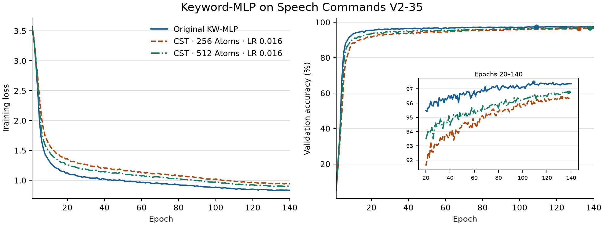

# CST Keyword-MLP

[English](README.md) | 日本語

Speech Commands V2-35で[公式Keyword-MLP](https://github.com/AI-Research-BD/Keyword-MLP/tree/a87c8ac9c4d3ba01745d68cc5dcf9cd21dd67b72)
とCST版を一から学習します。CST版は12ブロックそれぞれのゲートにある98→98の時間軸変換に
CSTLinearを使います。元版のカーネルサイズ1の畳み込みは、各特徴チャネルに同じ時間軸の
重み行列を掛けます。CST版もバイアスを1から始め、初期重みのスケールを揃えています。
他の層は公式アーキテクチャを使います。同梱モデルのライセンスは[こちら](upstream/LICENSE)です。

## Speech Commands V2-35の結果

| モデル | Atom学習率 | シード | 最終テスト精度 | 検証最良時点のテスト精度 | 検証95%に初到達 |
| --- | ---: | ---: | ---: | ---: | ---: |
| 元版 | — | 17 | 97.35% | 97.19% | 17エポック |
| CST 128 Atom | 0.0048 | 17 | 95.21% | 95.20% | 104エポック |
| CST 128 Atom | 0.016 | 17 | 95.27% | 95.24% | 101エポック |
| CST 256 Atom | 0.016 | 17 | 96.17% | 96.27% | 66エポック |
| CST 512 Atom | 0.016 | 17 | 96.49% | 96.52% | 39エポック |
| 元版 | — | 29 | 97.48% | 97.28% | 15エポック |
| CST 256 Atom | 0.016 | 29 | 96.11% | 95.88% | 55エポック |

シード17ではAtomを増やすとテスト精度が改善しました。各ゲート512 Atomでは、
学習パラメータが元版の424,811から334,139に減り（21.3%減）、最終テスト精度の差は
0.85ポイントでした。512 Atom版の初回実験では、最終チェックポイントを再読み込みすると
11,005件中1件だけ正答数が変わりました。表は学習終了時の値です。



[128 Atomと256 Atomの曲線](results/curves-128-256.png) · [シード29の曲線](results/curves-seed29.png) · [集計と実行方式の計測](results/summary.json) · [エポック履歴](results/history.csv)

## 推論

16 kHz・モノラル・PCM16のWAVを入力すると、35種類の音声コマンドのうち確率上位5件を
返します。[Hugging Face](https://huggingface.co/takumiecd/cst-keyword-mlp)では、
同条件で再学習した元版と512 Atom版から検証精度で選んだ重みを配布します。
配布チェックポイントの評価値はモデルの設定ファイルに記録しています。

```bash
python -m pip install -r requirements.txt
python infer.py command.wav --variant cst-512
```

元版との比較は `--variant baseline`、CUDA対応環境でGPUを使う場合は
`--device cuda` を指定します。

## RTX 4090での短時間測定

| モデル | 1ステップの中央値 | ピーク割り当てVRAM | ピーク予約VRAM | パラメータ数 |
| --- | ---: | ---: | ---: | ---: |
| 元のKW-MLP | 8.79 ms | 1,234.2 MiB | 1,460 MiB | 424,811 |
| CST版、各変換に128 Atom | 28.41 ms | 1,239.8 MiB | 1,470 MiB | 315,707 |

バッチ256、シード17、FP32・TF32有効、PyTorch 2.6.0・CUDA 12.6で測定しました。
各モデルは別プロセスで2回実行し、各回15更新のウォームアップ後に60更新を計測しました。
時間は計120更新の中央値、VRAMはPyTorchアロケータの2回の最大値です。GPU上に準備済みの
バッチを使い、勾配のクリアから順伝播、逆伝播、重み更新までを含みます。両モデルで入力と
共通パラメータの初期値を揃えました。別に各1エポックを実行し、検証で選んだ重みを保存・
再読み込みして、テスト分割で評価できることも確認しました。

## 準備と実行

Python 3.10以降でCUDA対応のPyTorchとtorchaudioを同じバージョンで使います。
計測ではPyTorch・torchaudioともに2.6.0+cu126を使いました。

```bash
python -m pip install -r requirements.txt
mkdir -p data/speech_commands_v0.02
curl -fL https://storage.googleapis.com/download.tensorflow.org/data/speech_commands_v0.02.tar.gz \
  -o data/speech_commands_v0.02.tar.gz
tar -xzf data/speech_commands_v0.02.tar.gz -C data/speech_commands_v0.02
python data.py --data data/speech_commands_v0.02 --cache data/scv2-mfcc
```

公式分割の学習84,843件・検証9,981件・テスト11,005件を使用します。窓30 ms、ホップ10 ms
で40×98のMFCCをキャッシュし、学習時に両モデルで同じSpecAugmentを適用します。

```bash
# 短時間の測定
for variant in baseline cst; do
  OMP_NUM_THREADS=2 MKL_NUM_THREADS=2 python train.py --variant "$variant" \
    --cache data/scv2-mfcc --output "output/pilot-$variant" \
    --batch-size 256 --seed 17 --atoms 128 --pilot-warmup 15 --pilot-updates 60
done

# 一から本学習
for variant in baseline cst; do
  OMP_NUM_THREADS=2 MKL_NUM_THREADS=2 python train.py --variant "$variant" \
    --cache data/scv2-mfcc --output "output/full-pair/$variant" \
    --batch-size 256 --seed 17 --atoms 128 --epochs 140
done
```

公開用の設定で学習するには、上の本学習コマンドを `--atoms 512 --atom-lr 0.016` に変更し、
`python export.py --run output/full-pair --output output/weights` で重みを書き出します。

本学習では学習率を10エポックかけて上げ、コサイン減衰します。基準学習率は通常の
パラメータが0.001、CSTのAtomが0.0048です。CSTの既定バックエンドは
`materialized` です。各実行で `metrics.json` を出力します。本学習では検証精度が最高に
達した最初のエポックを `best.pt`、最終エポックを `last.pt` に保存します。メトリクスには
両チェックポイントのテスト精度と、エポックごとの学習損失・検証結果を記録します。
`baseline/metrics.json` と `cst/metrics.json` が入ったディレクトリを指定すると、
以下のコマンドで学習曲線を作成できます。

```bash
uv run --with matplotlib python plot.py --run output/full-pair \
  --output output/full-pair/learning-curves.png
```
