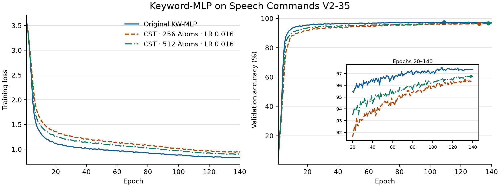

# CST Keyword-MLP

English | [日本語](README.ja.md)

Train the [official Keyword-MLP](https://github.com/AI-Research-BD/Keyword-MLP/tree/a87c8ac9c4d3ba01745d68cc5dcf9cd21dd67b72)
and a CST variant from scratch on Speech Commands V2-35. The CST variant
replaces the 98-to-98 temporal projection in each of the 12 spatial gating
units. The original kernel-size-one convolution applies one temporal weight
matrix per feature channel. The CST variant retains the bias initialized to
one and matches the small initial weight scale. All other layers use the
official architecture.
The vendored model is covered by the [upstream license](upstream/LICENSE).

## Speech Commands V2-35 results

| Model | Atom LR | Seed | Final test accuracy | Test accuracy at the best validation epoch | Epoch first at 95% validation |
| --- | ---: | ---: | ---: | ---: | ---: |
| Original KW-MLP | — | 17 | 97.35% | 97.19% | 17 |
| CST, 128 Atoms | 0.0048 | 17 | 95.21% | 95.20% | 104 |
| CST, 128 Atoms | 0.016 | 17 | 95.27% | 95.24% | 101 |
| CST, 256 Atoms | 0.016 | 17 | 96.17% | 96.27% | 66 |
| CST, 512 Atoms | 0.016 | 17 | 96.49% | 96.52% | 39 |
| Original KW-MLP | — | 29 | 97.48% | 97.28% | 15 |
| CST, 256 Atoms | 0.016 | 29 | 96.11% | 95.88% | 55 |

Increasing the Atom count improved test accuracy on seed 17. At 512 Atoms per
gate, the model used 334,139 trainable parameters versus 424,811 for the original
(21.3% fewer), and its final test accuracy trailed by 0.85 percentage points.
For the first 512-Atom run, reloading the final checkpoint changed the test
count by one of 11,005 clips. The table reports the count from the training run.



[128- and 256-Atom curves](results/curves-128-256.png) · [Seed 29 curves](results/curves-seed29.png) · [Run summary and backend timings](results/summary.json) · [Epoch history](results/history.csv)

## Run inference

Use a 16 kHz mono PCM16 WAV file. The CLI returns the top five of the 35
Speech Commands labels. The [Hugging Face release](https://huggingface.co/takumiecd/cst-keyword-mlp)
contains validation-selected checkpoints from matched release reruns of the
original model and the 512-Atom CST model. The release checkpoint scores are
recorded in the model configuration.

```bash
python -m pip install -r requirements.txt
python infer.py command.wav --variant cst-512
```

Set `--variant baseline` to compare, or `--device cuda` to use a CUDA build.

## RTX 4090 pilot

| Model | Median step | Peak allocated VRAM | Peak reserved VRAM | Parameters |
| --- | ---: | ---: | ---: | ---: |
| Original KW-MLP | 8.79 ms | 1,234.2 MiB | 1,460 MiB | 424,811 |
| CST, 128 Atoms per projection | 28.41 ms | 1,239.8 MiB | 1,470 MiB | 315,707 |

Batch size 256, seed 17, FP32 with TF32 enabled, PyTorch 2.6.0 and CUDA 12.6.
Each model ran in two fresh processes with 15 warmup updates and 60 measured
updates each. The median pools 120 measurements. VRAM is the maximum of
the two rounds using PyTorch allocator statistics. Timing covers the full
optimizer update on an already prepared GPU batch, including forward,
backward, and gradient clearing. Both models used the same examples and the
same initial values for shared parameters. Each also completed a separate
one-epoch run that saved and reloaded the validation-selected checkpoint
and evaluated it on the test split.

## Prepare and run

Use Python 3.10 or newer and a matching CUDA-enabled PyTorch/torchaudio pair.
The cluster pilot used PyTorch and torchaudio 2.6.0+cu126.

```bash
python -m pip install -r requirements.txt
mkdir -p data/speech_commands_v0.02
curl -fL https://storage.googleapis.com/download.tensorflow.org/data/speech_commands_v0.02.tar.gz \
  -o data/speech_commands_v0.02.tar.gz
tar -xzf data/speech_commands_v0.02.tar.gz -C data/speech_commands_v0.02
python data.py --data data/speech_commands_v0.02 --cache data/scv2-mfcc
```

The feature cache uses the official train, validation, and test split (84,843,
9,981, and 11,005 clips). The 40-by-98 MFCC frontend uses a 30 ms window and a
10 ms hop. SpecAugment is shared across both training variants.

```bash
# Short measurement
for variant in baseline cst; do
  OMP_NUM_THREADS=2 MKL_NUM_THREADS=2 python train.py --variant "$variant" \
    --cache data/scv2-mfcc --output "output/pilot-$variant" \
    --batch-size 256 --seed 17 --atoms 128 --pilot-warmup 15 --pilot-updates 60
done

# Training from scratch
for variant in baseline cst; do
  OMP_NUM_THREADS=2 MKL_NUM_THREADS=2 python train.py --variant "$variant" \
    --cache data/scv2-mfcc --output "output/full-pair/$variant" \
    --batch-size 256 --seed 17 --atoms 128 --epochs 140
done
```

To use the release configuration, set `--atoms 512 --atom-lr 0.016` in
the full-training command above, then run
`python export.py --run output/full-pair --output output/weights`.

The full run uses 10 epochs of learning-rate warmup and cosine decay. Ordinary
parameters start from a base learning rate of 0.001 and the CST Atom group
uses 0.0048. The CST backend defaults to `materialized`. Each run writes
`metrics.json`. Full training saves `best.pt` at the first epoch with the
highest validation accuracy and `last.pt` at the final epoch. The metrics
record the test scores for both checkpoints and the training loss and
validation scores for every epoch. To plot the paired curves from a directory
containing `baseline/metrics.json` and `cst/metrics.json`, run the following.

```bash
uv run --with matplotlib python plot.py --run output/full-pair \
  --output output/full-pair/learning-curves.png
```
